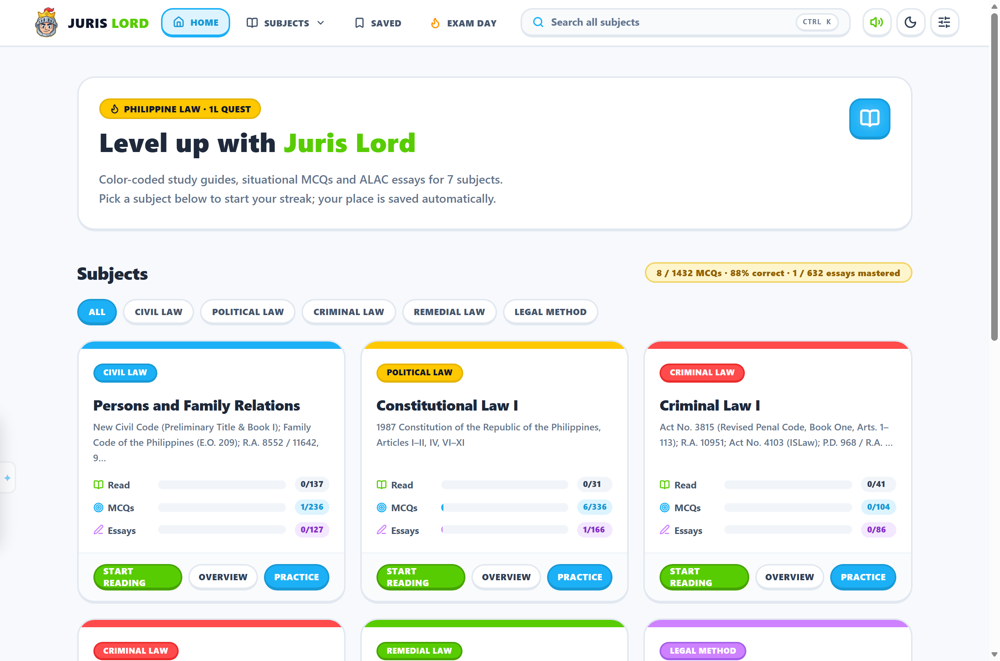
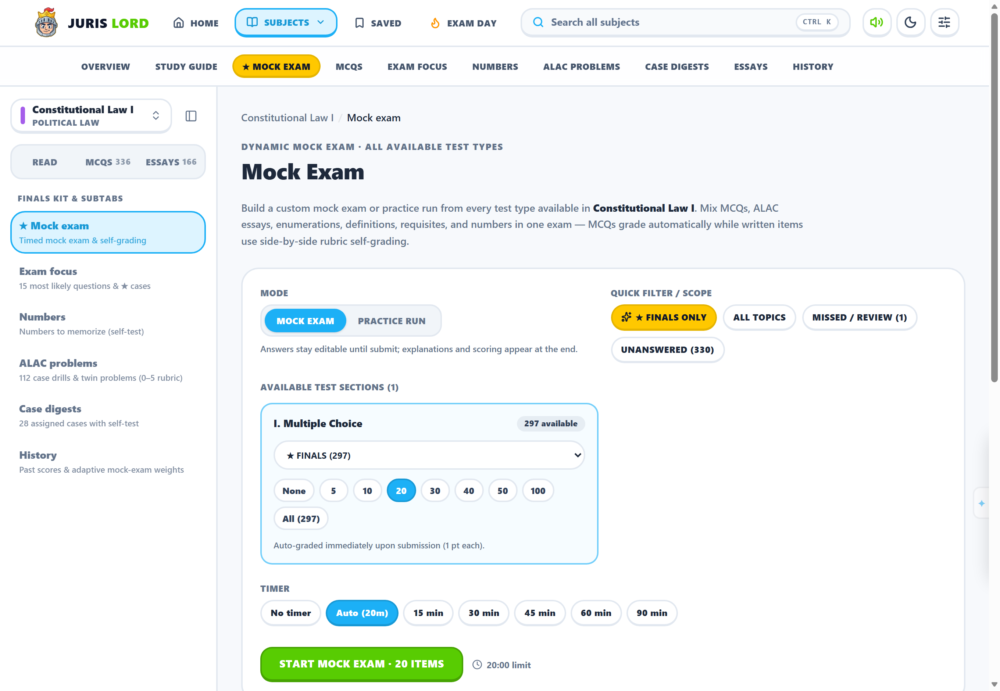
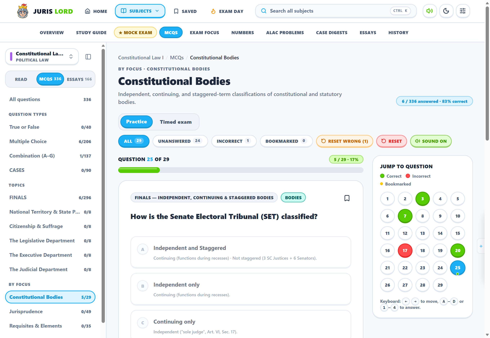
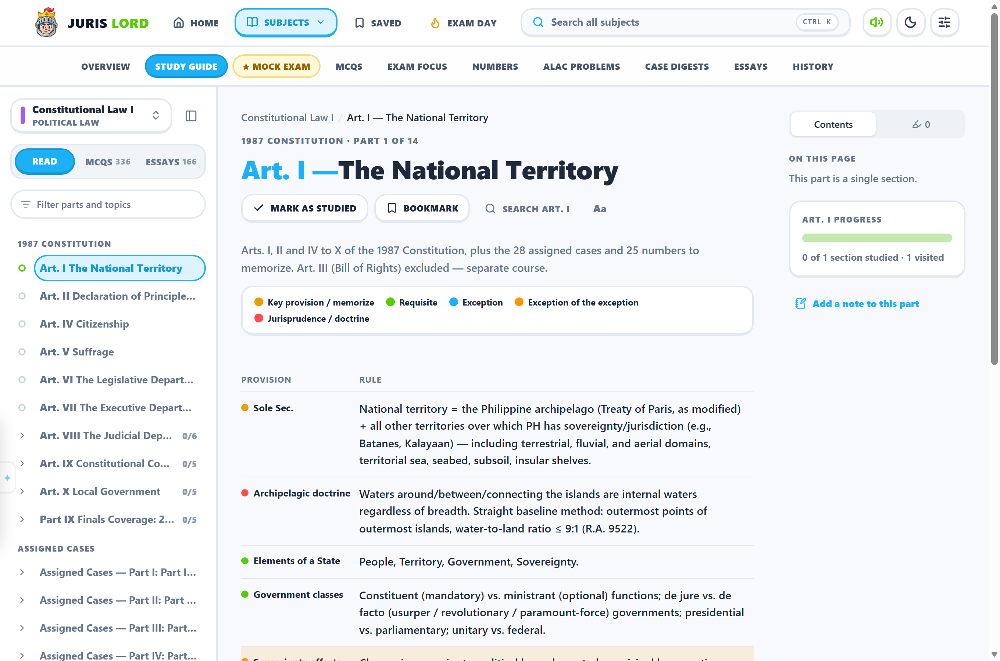
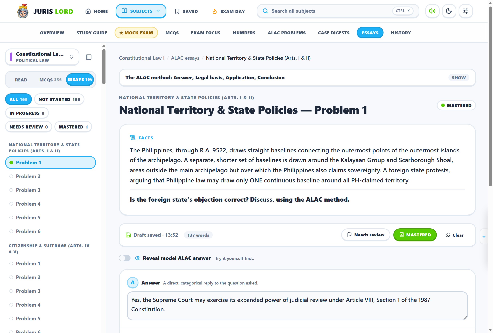
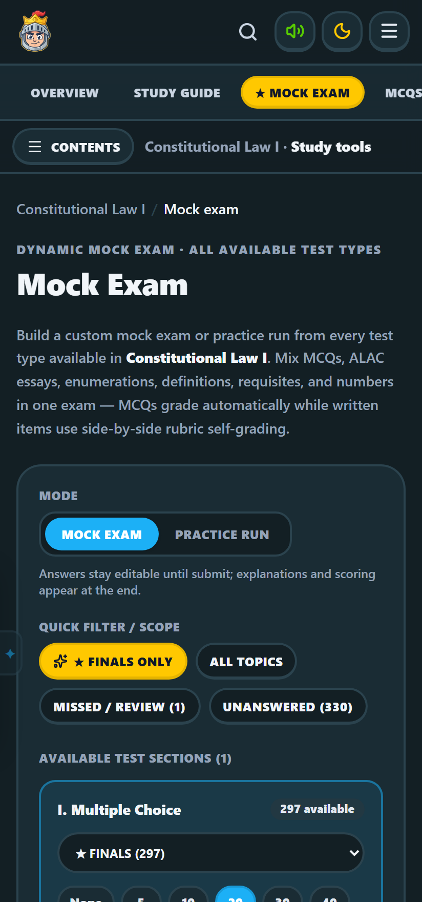

<p align="center">
  
</p>

<h1 align="center">Juris Lord</h1>

<p align="center">
  <em>"Shall we test your legal might today, my Lord?"</em><br />
  An offline-first Philippine law reviewer, adaptive mock-exam engine, situational MCQ trainer, and ALAC essay workspace.
</p>

---

## Acknowledgements

- **lourinsi** — Amended, expanded, and rebranded the platform into **Juris Lord**, authoring the comprehensive Finals master drills (including the 296-item Constitutional Law I Finals & Jurisprudence drill and the 8-choice Constitutional Bodies taxonomy), the Judge Lloren Criminal Law I reviewer & ISLaw module, the Unified Mock Exam engine, and the adaptive post-submission question weighting system.
- **Anthony (`serocode`)** — Original code, reader architecture, CSS Custom Highlight engine, and foundational study-guide design.

---

## Overview

**Juris Lord** is a zero-backend, local-first web application for mastering Philippine law subjects. It combines color-coded codal & doctrinal study guides, case digests, an adaptive **★ Mock Exam** simulator, situational MCQ practice with dynamic option shuffling, and **ALAC** (**A**nswer, **L**egal Basis, **A**pplication, **C**onclusion) essay drills with side-by-side model answers.

There is no account and no server required—all study progress, highlights, notes, essay drafts, test history, and adaptive question weights persist locally in your browser's `localStorage` with full JSON backup export/import.

Built with **SvelteKit 3 (Svelte 5 runes)** · **Tailwind CSS v4** · **shadcn-svelte** · **Vercel Web Analytics**.



---

## Key Features

### 1. ★ Unified Mock Exam & Adaptive Question Weights



- **Multi-Part Exam Simulator (`/module/<slug>/exam`):** Combine MCQs, ALAC Essays, Enumerations, Definitions, Requisites, and Numbers & Periods into a single timed mock exam or untimed practice run.
- **One-Click ★ Finals Presets:** Defaults to a **20-Question ★ Finals Mock Exam** with an automatic 1-minute-per-question countdown timer, plus one-click post-submission actions (*New 20-Question Set*, *Retake Missed*, *Take Full ★ Finals*, or *Customize Exam*).
- **Interactive Exam Controls:**
  - **1-per-page vs. Full-scroll toggle** (`Single` / `All`)
  - **Hover-to-pause countdown timer** (or click to pause/resume)
  - **Instant answer reveal toggle** (eye icon to show/hide answers during a run)
  - **Reset wrong** (clears only incorrect MCQ selections and reshuffles their choices) & **Reset exam**
- **Adaptive Post-Submission Sampling Weights:**
  - Applies automatically to subset mock exams (e.g., `5`, `10`, `20`, `30`, `40`, `50`, `100` items—any selection other than *All*).
  - **Updates after submission:** Every question starts at base weight **`1×`**.
    - **Answered right:** Weight is lowered by **50%** (`1× → 0.5× → 0.25× → 0.125× …`), floored above zero (`0.005×`) so mastered questions become progressively less likely to reappear but are **never permanently exterminated**.
    - **Answered wrong:** Weight is increased by **50%** (`1× → 1.5× → 2.25× → 3.375× …`) so weak spots reappear more frequently.
    - **Direction flip resets to base (`1×`) first:** Getting a previously lowered question (`< 1×`) wrong immediately resets it to base `1×` and boosts it by `+50%` to **`1.5×`**. Conversely, getting a previously boosted question (`> 1×`) right immediately resets it to base `1×` and lowers it by `-50%` to **`0.5×`**.
  - **Per-Subject History Tab (`/module/<slug>/history`) & Saved → History (`/saved?tab=history`):** Displays all past exam scores alongside every question whose weight has been modified from base `1×` (unchanged `1×` questions are hidden), with `More likely` / `Less likely` filters and one-click per-item or per-subject reset to `1×`.

### 2. Situational MCQ Practice Engine



- **Dynamic Question & Choice Jumbling:** Questions jumble automatically on load (unless a timed exam is currently running), and choices shuffle dynamically while respecting letter references (*"Both A and B"*) and pinning positional choices (*"None of the above"*, *"All of the above"*) to the last slot.
- **Automatic Sub-Topic & Focus Filters Across All Subjects:**
  - **Question Types:** *True or False*, *Multiple Choice*, *Combination (A–G)*, and *CASES*.
  - **By Focus:** *Constitutional Bodies* (8-choice `Independent / Continuing / Staggered` taxonomy), *Jurisprudence*, *Requisites & Elements*, *Exceptions & Traps*, *Effects & Remedies*, and *Codal & Memorization*.
- **Practice & Timed Exam Modes:** Instant per-option feedback and expandable **Codal basis & explanation** drawer in Practice mode; strict no-peek countdown in Timed Exam mode.
- **Keyboard Shortcuts:** `←` / `→` to navigate, `A`–`H` or `1`–`8` to pick an option, and `N` to advance.

### 3. Color-Coded Study Guides, Case Digests & Highlights



- **Subject → Part → Topic Hierarchy:** Collapsible doctrinal topics, progress tracking (*Visited* vs. *Studied*), breadcrumbs, and deep links (`/module/<subject>/read/<part>#<topic>`).
- **5-Color Text Highlighter & Linked Notes:** Select any passage in a study guide or case digest to highlight in five customizable categories (*Memorize*, *Requisites*, *Exceptions*, *Jurisprudence*, *Compare & contrast*) and attach notes—painted non-destructively via the CSS Custom Highlight API.
- **Customizable Typography:** Adjust font family (Serif / Sans), text size, line height, and reading measure per browser.

### 4. ALAC Essay Exercises & Special Drills



- **4-Part ALAC Workspace:** Draft structured responses under **A**nswer, **L**egal Basis, **A**pplication, and **C**onclusion with live word counts and auto-save, then reveal the model ALAC answer side-by-side.
- **Subject Finals Kits:** Dedicated tabs for **Exam Focus** (most likely bar/finals questions), **Numbers & Periods** (interactive self-test tables), **Requisites & Rules**, **Enumerations**, **Definitions & Latin Maxims**, **Twist Drills**, **One Fact Flips It**, and **Spaced-Repetition Flashcards**.

### 5. Responsive Dark Mode & Local Backups

<p align="center">
  
</p>

- **Mobile & Tablet Ready:** Slide-over navigator sheets, sticky exam timers, and dark/light/system themes.
- **Full JSON Export & Import (`/settings`):** Back up and restore all MCQ attempts, adaptive exam weights, test history, essay drafts, bookmarks, highlights, and notes across devices.

---

## Subjects Covered

| Subject | Category | Coverage | MCQs | Essays / Problems | Case Digests |
| --- | --- | --- | ---: | ---: | ---: |
| **Persons and Family Relations** | Civil Law | New Civil Code (Preliminary Title & Book I) · Family Code (E.O. 209) · R.A. 8552 / 11642, 9255, 9858, 9048 / 10172 · Case pronouncements | 236 | 127 | 130 |
| **Constitutional Law I** | Political Law | 1987 Constitution (Arts. I–II, IV–XVIII) · Structure of Government · Cruz *Philippine Political Law* Finals Master Drill, 90 Landmark Cases Drill & 29 Constitutional Bodies (8-choice taxonomy) | 336 | 166 | 28 |
| **Criminal Law I** | Criminal Law | Revised Penal Code, Book One (Arts. 1–113) · R.A. 10951 · Act No. 4103 (ISLaw) · P.D. 968 / R.A. 10707 · R.A. 9344 | 104 | 86 | — |
| **Criminal Law I (Judge Lloren)** | Criminal Law | Judge Lloren Finals Reviewer (T/F, Multiple Choice & Case Problems), penalty graduation, and Indeterminate Sentence Law (ISLaw) mastery guide | 66 | 16 | — |
| **Criminal Procedure (Rules 110–127)** | Remedial Law | Revised Rules of Criminal Procedure (Rules 110–127) · Tiu Notes · BWC Rules · Cybercrime Warrants · 47 Requisites Q&A & Situational Drills | 503 | 145 | — |
| **Statutory Construction** | Legal Method | Agpalo *Statutory Construction* (Chapters I–XI) · Latin Maxims · Five Landmark Cases (*Catiis*, *Aquino*, *Manila Lodge*, *Corona*, *Magtajas*) | 177 | 69 | 5 |
| **Philosophy of Law** | Legal Method | Lessons 10–13 Jurisprudence Syllabus · Schools of Jurisprudence, 24 Thinkers, Stage Theories, Critiques & 10 Philippine Supreme Court Decisions | 10 | 23 | 10 |
| **Total** | | | **1,432** | **632** | **173** |

---

## Development

```sh
npm install
npm run dev      # Start local dev server at http://localhost:5173
npm run check    # Run svelte-kit sync + svelte-check
npm run build    # Build static SPA into build/ (fallback: 200.html)
```

---

## Project Structure

- `src/lib/data/` — Subject modules (`pfr.ts`, `pfr_ext.ts`, `pfr_cases.ts`, `consti1.ts`, `consti1_ext.ts`, `consti1_finals_mcqs.ts`, `crim1.ts`, `crim1_lloren.ts`, `statcon.ts`, `statcon2/`, `crimpro/`, `philo.ts`) and lazy-loaded subject registry (`modules.svelte.ts`).
- `src/lib/unified-exam.ts` — Unified Mock Exam bank builder, weighted random sampling without replacement (`sampleWeightedItems`), scoring helpers, and per-subject session persistence.
- `src/lib/topics.ts` — Automatic discovery of syllabus topics, Question Type sub-topics (*True or False*, *Multiple Choice*, *Combination A–G*, *CASES*), and Focus sub-topics (*Constitutional Bodies*, *Jurisprudence*, *Requisites*, *Exceptions*, *Effects*, *Codal & Memorization*).
- `src/lib/subtabs.ts` — Per-subject navigation tabs (`Overview`, `Study guide`, `★ Mock exam`, `MCQs`, `Exam focus`, `Numbers`, `Requisites`, `Enumerations`, `Definitions`, `ALAC problems`, `Case digests`, `Essays`, `History`).
- `src/lib/stores/storage.svelte.ts` — Reactive `localStorage` persistence (`mcqAttempts`, `examWeights`, `testHistory`, `essayDrafts`, `bookmarks`, `highlights`, `reading`), cross-tab sync, and JSON export/import.
- `src/lib/components/` — `Mascot.svelte` (animated Juris Lord knight logo), `McqQuizEngine.svelte`, `AlacEssayEditor.svelte`, `SubjectEntryModal.svelte`, `exam/UnifiedMockExam.svelte`, and shell/reader components.
- `src/routes/` — Dashboard (`/`), Saved & History (`/saved`), Global Search (`/search`), Exam Day (`/exam-day`), Settings (`/settings`), and per-subject routes (`/module/[slug]/*`).
